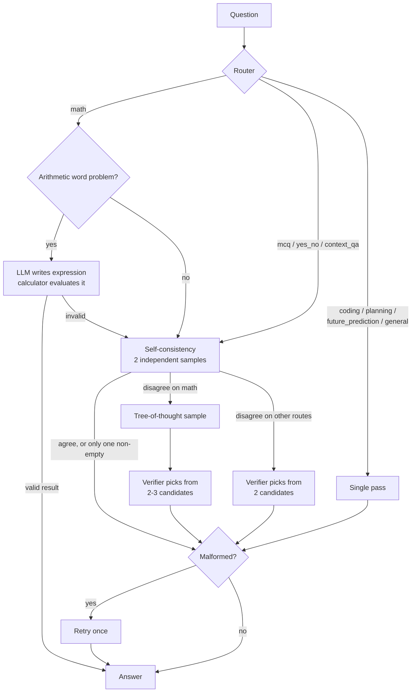

# CSE 476 Final Project: Inference-Time Reasoning Agent

A general-purpose reasoning agent that answers math, coding, planning,
common-sense and forecasting questions. It gets better accuracy out of a fixed
open-weight LLM (`qwen3-30b-a3b-instruct-2507`) through **inference-time
techniques** alone: no fine-tuning, no external models, no web search.

## Table of Contents

- [Overview](#overview)
- [How It Works](#how-it-works)
- [Project Structure](#project-structure)
- [Getting Started](#getting-started)
- [Usage](#usage)
- [Data Format](#data-format)
- [Constraints](#constraints)
- [Reproducing Results](#reproducing-results)

## Overview

### The problem

A single prompt to an LLM is often wrong in predictable ways. It slips on
arithmetic, wraps a one-word answer in a paragraph, ignores the required
output format, or commits to its first line of reasoning. The CSE 476 final
project asks for an agent that improves on this **using only the provided
model**, with a hard limit of **20 LLM calls per question**.

### What this project does

The agent takes a question, works out what kind of question it is, and runs a
reasoning strategy suited to that kind. It then cleans the model's raw output
into the exact answer format the auto-grader expects. The batch runner sends
the full test set (6,208 questions) through the agent and writes a validated
answers file for submission.

### Highlights

- **Question routing.** Fast rule-based classification into 8 categories
  (math, MCQ, yes/no, context QA, coding, planning, future prediction,
  general), so each one gets its own prompt and strategy.
- **Self-consistency with verification.** Two independent attempts. If they
  disagree, a verifier call picks the better answer.
- **Tree-of-thought for hard math.** When attempts disagree, the agent
  explores algebraic, geometric and counting approaches before verifying.
- **Tool use.** Arithmetic word problems become a Python expression that a
  sandboxed calculator evaluates, so the model never does the arithmetic
  itself.
- **Self-correction.** Malformed answers (empty, missing digits, missing a
  `\boxed{}`, and so on) trigger one targeted retry.
- **Answer normalization.** Strips reasoning, labels and markdown fences, and
  pulls out the final number, letter, yes/no or boxed value.
- **Budget enforcement.** `CallCounter` hard-caps every question at 20 calls.
  In practice the agent uses 1–6.
- **Runs that survive crashes.** Parallel workers, atomic periodic saves, and
  automatic resume from partial output.
- **Two backends.** The hosted ASU SOL API, or a self-hosted Ollama server on
  a SOL GPU node, with automatic retries on transient errors.

## How It Works



Every model response is normalized (route-specific cleanup) right after the
call, so samples are compared on their cleaned answers. A calculator result
is returned as-is and skips the malformed check.

| Technique | Where it's used | Calls |
|---|---|---|
| Route-specific prompting | Every route. Most prompts ask for the answer only, while math reasons step by step and ends with `Final answer:` | 1 |
| Tool-augmented arithmetic | Math word problems with arithmetic keywords and numbers | 1 |
| Self-consistency | Math, MCQ, yes/no, context QA. For math, the second sample uses a decomposition prompt | 2 |
| Tree-of-thought | Math, only when the two samples disagree | +1 |
| LLM-as-verifier | Any self-consistency route where samples disagree | +1 |
| Format-aware retry | Any route whose answer fails the malformed check | +1 |

First-pass calls use `temperature=0.0`. Only the second self-consistency
sample (`0.2`) and the tree-of-thought call (`0.3`) use a higher temperature,
so most answers are deterministic for a given model.

## Project Structure

```
.
├── src/
│   ├── generate_answers.py     # Batch runner: input JSON → validated answers JSON
│   ├── evaluate_answers.py     # Offline per-domain accuracy on labeled data
│   └── agent/
│       ├── graph.py            # Agent pipeline and inference techniques (+ interactive CLI)
│       ├── router.py           # Rule-based question classifier
│       ├── client.py           # HTTP client for SOL / Ollama with retries
│       ├── tools.py            # Sandboxed arithmetic calculator
│       ├── normalize_answer.py # Route-specific output cleanup
│       ├── call_counter.py     # Per-question 20-call budget
│       └── agent_logger.py     # Logs every prompt/response to agent.log
├── scripts/
│   └── ollama_serve.sh         # Starts an Ollama server on a SOL GPU node
├── data/
│   ├── input/                  # Provided dev/test question files
│   └── output/                 # Generated answer files
├── docs/                       # Assignment PDF, submission template, tutorial notebook
├── .env.example                # Environment variable template
└── pyproject.toml
```

## Getting Started

### Prerequisites

- Python 3.10+
- One of:
  - an ASU SOL API key (from the ASU Research Computing dashboard), or
  - access to a SOL GPU node for the Ollama backend

### Installation

```bash
git clone <repo-url>
cd inference_project

python -m venv venv
source venv/bin/activate          # macOS / Linux
# venv\Scripts\activate           # Windows

python -m pip install -e .
```

This installs the dependencies (`requests`, `python-dotenv`) and registers two
console scripts: `generate-answers` and `evaluate-answers`.

### Configuration

```bash
cp .env.example .env
```

| Variable | Default | Description |
|---|---|---|
| `OPENAI_API_KEY` / `LLM_API_KEY` | — | SOL API key. Required for the cloud backend |
| `API_BASE` | `https://openai.rc.asu.edu/v1` | OpenAI-compatible endpoint |
| `MODEL_NAME` | `qwen3-30b-a3b-instruct-2507` | Model to query. The submission must use this model |
| `BACKEND` | *(unset)* | Set to `ollama` to use a self-hosted Ollama server (no API key needed) |

## Usage

### Generate answers (batch)

Input and output paths are set at the top of
[src/generate_answers.py](src/generate_answers.py). Commented-out pairs are
provided for the smoke, dev and test sets. By default it points at the
official test set:

```python
INPUT_PATH  = ROOT / "data" / "input" / "cse_476_final_project_test_data.json"
OUTPUT_PATH = ROOT / "data" / "output" / "cse_476_final_project_answers.json"
```

Run it from the project root:

```bash
generate-answers
# or: python src/generate_answers.py
```

What the runner does:

- Answers questions in parallel (`MAX_WORKERS = 8`).
- Saves progress every 10 completed questions, using an atomic temp-file
  rename so a crash never leaves a half-written file.
- On restart, skips questions that already have a real answer, so you can
  stop and resume at any time.
- Records `"unknown"` for any question that raises an error and keeps going.
- Validates the final file: every entry has a string `output` under 5,000
  characters.

### Try the agent interactively

```bash
python -m agent.graph
```

```
Enter a question (or 'exit'): Is the Pacific the largest ocean?
AI: yes
```

### Evaluate on labeled data

[src/evaluate_answers.py](src/evaluate_answers.py) exact-matches predictions
against a labeled file (such as the dev split) and prints per-domain and
overall accuracy. Set `PREDICTED_PATH`, `EXPECTED_PATH` and `RESULT_PATH` at
the top of the file, make sure the result directory exists, then run:

```bash
evaluate-answers
```

### Run with Ollama on SOL (optional)

1. On a SOL GPU node, start the server:
   ```bash
   bash scripts/ollama_serve.sh
   ```
   It prints the node's `BASE_URL` (for example `http://sg003:11434`).
2. Update `.env`:
   ```bash
   BACKEND=ollama
   API_BASE=http://<node>:11434/v1
   MODEL_NAME=alibayram/Qwen3-30B-A3B-Instruct-2507
   ```
   The model downloads on first use.
3. Run `generate-answers` as usual.

### Logging

Every request and response (system prompt, user prompt, model output, HTTP
errors) is written to `agent.log` in the repo root. The file is overwritten on
each run. Failed requests are retried up to 3 times, 10 seconds apart, on
network errors and HTTP 5xx responses.

## Data Format

**Input**: a JSON list of question objects. Labeled files also include
`output` and `domain`:

```json
[
  { "input": "Find the area of quadrilateral ABCD ...", "output": "112", "domain": "math" }
]
```

**Output**: a JSON list in the same order, one string answer per question:

```json
[
  { "output": "112" }
]
```

The dev set has 1,000 labeled questions across five domains: common sense
(400), math (300), coding (100), future prediction (100) and planning (100).

## Constraints

This project follows the assignment rules:

- **Single model, single provider.** Only the SOL endpoint (or the same Qwen3
  model self-hosted via Ollama). No GPT, Claude or other external LLMs.
- **No external services.** No paid APIs, search APIs or other internet calls.
- **No full delegation.** The calculator only evaluates arithmetic. The model
  still has to decide what to compute.
- **20 calls per question**, enforced by `CallCounter`.

## Reproducing Results

1. Install and configure as described in [Getting Started](#getting-started).
2. Place the official test file at
   `data/input/cse_476_final_project_test_data.json`.
3. Make sure `.env` has a valid SOL key and
   `MODEL_NAME=qwen3-30b-a3b-instruct-2507`.
4. Run `generate-answers`.
5. The submission file is written to
   `data/output/cse_476_final_project_answers.json`.
